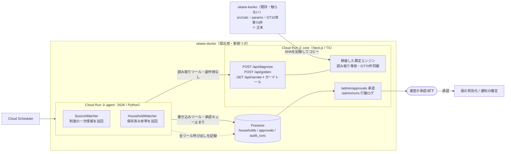
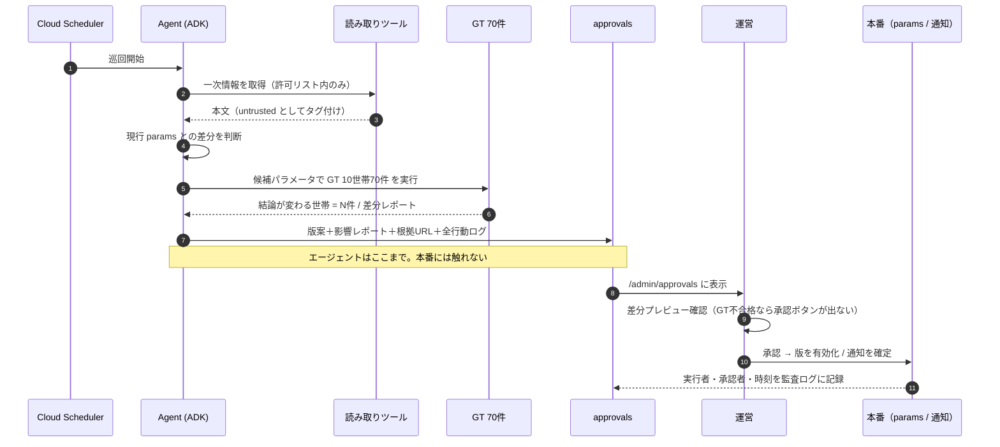
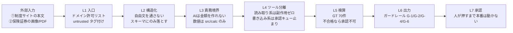

# 第5回 Agentic AI Hackathon vol.5 ─ 提出用アプリの作戦

> 版：2026-09-04（全面改訂）。明日 9/5（土）渋谷ミニハッカソンの持ち込み資料。
> 提出締切 10/15、最終ピッチ 12/1。参加者向けスキルは `.claude/skills/gc-hackathon-vol5{,-ideation}` に導入済み。
> UIモックアップ（5画面）は別途 Artifact「お金の主治医 UI」にある。
> 置き場所：`okane-kenko/docs/hackathon/2026-09-04_vol5-plan.md`

---

## 0. この版で決めたこと（要約）

| # | 決定 |
|---|---|
| 1 | **okane-kenko（事業本体）は今のまま残す。** 提出用に新アプリ（仮称 `okane-doctor` / お金の主治医）を立て、使える資産を移植する |
| 2 | 看板は **「自分で背負える線を引き、その線を一生見張り続けるAI」** |
| 3 | **「保険はたいてい要らない」という言い方は使わない**（撤回）。芯は条件つきの「必要ないなら入らなくていい」であって、断定ではない |
| 4 | 自律性は **制度ウォッチャー一本**に絞る。問診エージェントは降格。ただし設問を1つだけ足す（D-03） |
| 5 | **欠測の埋め方をユーザーに選ばせない**（D-01）。前提の水準は3つの目盛りで選ばせる（D-02） |

### 検討して捨てたもの（同じ道を二度通らないための記録）
- 申し送りの案①「サブスク重複・支出急変の巡回検知」── `SPEC.md` Out of Scope と真っ向から衝突。勝てない土俵
- コールセンター／解約電話を看板にする案 ── 検証できない領域を主戦場にできない
- 広告運用の内情を語る路線 ── 同じ理由
- API をたくさん使う発想 ── 審査基準のどこにも「使用サービス数」は無い。③の費用対効果ではむしろ減点方向

---

## 1. 課題の立て方

保険は「要る／要らない」の二択ではない。**自分で背負える線が、どこにあるか**の話である。

- 線の**内側** ＝ 貯蓄・遺族年金・遺された人の就労収入で吸収できる範囲。ここまで保険で持つのが「払いすぎ」
- 線の**外側** ＝ 自力では吸収しきれない範囲。相互扶助で持つべきところ。ここが空いていると、安心して眠れない

**そして誰も、自分の線がどこにあるか知らない。** 保険会社は線を教えない（外側を売るのが仕事だから）。家計簿アプリは線を計算しない。FPは計算するが、有料で、1回きり。

**さらに、線は動く。** 子が18歳を超えれば遺族基礎年金が切れる。ローンを完済すれば団信が消える。制度が改正されれば公的保障の厚みが変わる。**去年ちょうどよかった保障は、今年ちょうどよくない。** そして動いたことに、本人は気づけない。

> 3分デモの一言：**「保険は、自分で背負えない分だけ持てばいい。でもその線は、毎年動く。動いたことに気づいて教えてくれる人が、いまどこにもいない。」**

「要らない」とは一言も言わない。**必要なところは必要だと言い、要らなくなったところだけ要らないと言う。**

---

## 2. 3軸での採点と、埋めるべき穴

| 審査軸 | 現状（okane-kenko） | 根拠 |
|---|---|---|
| ① 課題の新規性と解決策の有効性 | **強い** | 10世帯19死亡ケースで不足2件・減額余地12件・計約1億2,000万円。中立が構造的に成立する収益モデル（PEPM・手数料を取らない） |
| ② 自律性・エージェントらしさ | **ほぼ空** | 固定6ステップのフォーム → 決定的計算 → AIは翻訳のみ。「状況を判断しながら自律的に行動する」主体がいない |
| ③ 実装品質と拡張性 | **強い** | GT10世帯70件・ユニット151・E2E5・YAML版管理＋期限切れ停止・Cloud Run自動デプロイ・実測0.88円/診断 |

### ジレンマと、その解き方
このプロダクトの美点（**AIに金額を作らせない／判断させない／副作用を持たせない**）は、素直にやると軸②と正面衝突する。
だから**自律性を「金額の判断」以外に置く**。エージェントは何を出すかは決めない（算定エンジンの仕事）。
**何を確かめるべきか・いつ動くべきか・誰に何を渡すべきか**を決める。

**制度ウォッチャー一本に絞る理由**
1. 公開情報だけで完結する ── ヒアリング不要、当事者検証不要
2. 既存の宿題（`verified:false` を潰す）が同時に片付く
3. 「AIが自分でゴールデンテスト70件を回して判断する」画は、**検算済みの算定エンジンを持っている人しか作れない**

主人公はユーザーのまま。運営画面（承認・行動ログ）は「その自律性が暴走しない証拠」として裏側で見せる。

---

## 3. 設計決定 ─ 揺れの扱い方

> ユーザー情報に隙間があると結果が揺れる。これを「かつかつプラン／充実プラン」の二択にすべきか、を検討した結論。
> **性質の違う2つが混ざっているので、分けて扱う。**

### D-01　欠測の埋め方は、ユーザーに選ばせない
対象：「分からない」「答えたくない」で欠けた項目（既存の `Estimation[]` / `assumptions[]`）。

**選ばせてはいけない理由**
- 「充実」を選べる設計だと、**分からない項目が多い人ほど必要保障額が大きく出る**。情報を出さない人ほど手厚く勧められる構造で、これは保険営業のバイアスそのもの
- 「かつかつ」を既定にすると、**分からない人ほど「要らない」と言われる**。相互扶助の観点ではこちらのほうが罪が重い
- どちらに倒しても、答えの根拠が「本人がどのボタンを押したか」になる。それは診断ではなく設定

**採る扱い方**（既存の仕組みの延長）
- 推定で埋めた事実を `assumptions[]` として画面に出す（沈黙で誤解させない）
- **埋めた項目が多いほどレンジを広げる。** 「1,000万円」ではなく「900万〜1,150万円」、欠測が3つあれば「800万〜1,400万円」
- 揺れを隠さず、幅として見せる。これなら「情報を出せば線がはっきりする」というインセンティブになり、方向が正しい

### D-02　前提の水準は、3つの目盛りとして選べるようにする
対象：遺族生活費率 0.70 のような**公的出典のない当社基準**（ADR-014 が「結果画面で本人が動かせる」と既に決めている）。

いまは数値スライダーなので、**名前のついた3つの目盛り**にする。

| 目盛り | 意味 |
|---|---|
| 切り詰める | 今の7割で暮らす前提 |
| **いま通り**（既定） | 今と同じ水準を保つ前提 |
| ゆとりを持つ | 今より余裕を見る前提 |

- 実装済みの前提スライダー（PR #49「現状 vs 変更後」）の目盛りに名前を付けるだけ。画面は増えない
- **「プラン」という言葉は使わない。** 保険の商品プランと紛らわしく、選ぶ行為が商品選択に見える。呼び名は「暮らし方の前提」

### D-03　保障額の決め方を1問だけ聞く
「もうギリギリで入れている」人に「300万円減らせます」と出すのは的外れ。

> その保障額は、どうやって決めましたか？
> ・勧められるまま　・自分で計算した　・**保険料の上限から決めた**

3つ目なら、その人は既にかつかつで入れている。先に言うべきは「その保険料の範囲で、足りているかどうか」。**出す順番が変わる。**
（問診エージェントは降格したが、この1問は残す。エージェントが自律的に聞き分ける好例でもある）

### 残っている懸念（n1 で確かめる）
- **デフォルトが結果を支配する。** 「ゆとりを持つ」を並べた時点で「もっと備えたほうがいいのかな」という圧が生まれる。**選択肢を出すこと自体が中立ではない**
- **既定を「いま通り」にしてよいか自体が事業判断。** 遺族の生活は現実には変わる。0.70 は公的出典がないと `SPEC.md` 自身が書いている。ここは事業側が決めること

---

## 4. なぜ新アプリに分けるのか

okane-kenko は事業として正しく慎重に作られているが、その慎重さが**締切と相性が悪い**。

| okane-kenko の制約 | ハッカソンでの影響 |
|---|---|
| `verified:false` が全面的に残る＝本番では診断が停止する設計 | 審査員がデプロイURLを開くと 503 で止まりうる |
| 保険業法の線引きが弁護士レビュー待ち（OI-01） | 通知まわりに手を出せない |
| n1 未実施で H2 は仮GO | 事業判断が出るまで大きく動かせない |
| Phase A は「DBなし」 | 「継続的に見張る」エージェントが原理的に作れない |
| ゴールデン期待値の正本は xlsx の検算 | 実験のために数値を動かせない |

分ければ新アプリ側はこれらから自由になり、okane-kenko の `main` は1バイトも汚れない。

| | okane-kenko（既存） | 新アプリ（仮 `okane-doctor`） |
|---|---|---|
| 役割 | **健康診断** ─ 1回の測定を正確に | **主治医** ─ 継続的に診て、変化に気づき、処方箋を出す |
| 算定エンジン | **正本** | 読み取り専用コピー |
| 公開 | 非公開のまま | 提出用。GitHub連携は最大5つなので**両方連携する** |

> 両方連携する理由：「この算定は思いつきではなく、ゴールデン10世帯70件で検算された事業資産である」と示せる。

---

## 5. 移植の設計

### 移植するもの
| 移植元 | 扱い |
|---|---|
| `src/calc/**`（純粋関数・約2,468行） | **正本は okane-kenko。読み取り専用コピー**として持つ |
| `src/__tests__/golden.test.ts` + `households.ts` | 一緒に持つ。**移植直後に70件 green を確認する＝移植が壊れていない証明** |
| `params/*.yaml` + `src/params/index.ts` | verified ゲートの仕組みごと |
| `src/wizard/{types,normalize,complete}.ts` | 入力の受け皿。D-03 の設問もここに足す |
| `src/narrate/guard.ts`（ガードレール） | そのまま |
| `src/design/tokens.*` | そのまま |
| `app/result/*`（SVGチャート・検査値パネル・年次表・前提スライダー） | 使えるものを持つ。D-02 の目盛りはスライダーに足す |
| `CLAUDE.md` の責務境界・絶対にやらないこと | 新リポの `CLAUDE.md` に転記 |

### 持っていかないもの
ベイクオフ一式 / 老後モデル（PR #18） / n1 記録 / 本番前チェックリスト / handoff 群

### 同期事故を防ぐルール（新リポの CLAUDE.md に書く）
> **`src/calc/` `params/` は読み取り専用。ここを新アプリ側で直さない。**
> バグを見つけたら okane-kenko で直し、`SOURCE.md` の同期元コミットSHAと同期日を更新して再コピーする。逆流させない。
> 移植後は必ず `npm test` で GT 10世帯70件 green を確認する。

### 新アプリで意図的に変えること
- **Firestore を持つ**（世帯・承認キュー・監査ログ）。「DBなし」は引き継がない
- verified ゲートは残すが、デモ用に中核パラメータを一次情報で確認して `true` にする（制度ウォッチャーの副産物）
- 通知は**文面の下書きまで**（実配信しない＝募集の手前に留まる）

---

## 6. アーキテクチャ（たたき）

### 全体構成



**ツール一覧**

| 種別 | ツール | 副作用 |
|---|---|---|
| 読み取り | `call_diagnose(input)` / `run_golden_tests(candidate)` / `read_params()` / `fetch_official_source(url)`（ドメイン許可リスト） | なし |
| 書き込み | `propose_param_version()` / `draft_user_notice()` | **承認キューに積むだけ。本番には到達しない** |

### 承認フロー



### 多層防御（プロンプトインジェクション）



> **主張の核**：L3・L6 はハッカソンのために足した層ではない。2026-08 時点の `CLAUDE.md` に
> 「AIに金額を生成させない／AIに副作用を持たせない」と書かれていた設計をそのまま移植している。
> だからエージェント化しても、**インジェクションで金額が動く経路が構造的に存在しない**。

---

## 7. 明日（9/5）の最小スコープ

**ゴールは2つ。「移植が壊れていないこと」と「制度ウォッチャーが1周まわって承認待ちに積むこと」。**
世帯は Firestore に**シードで3件置くだけ**（実ユーザー不要、同意設計も不要）。

| # | やること | 完了の定義 | 目安 |
|---|---|---|---|
| **N-01** | 新リポ作成。`src/calc` `params` `src/wizard` `src/narrate/guard.ts` `src/design` とGTを移植 | **`npm test` で GT 10世帯70件 green**／`SOURCE.md` に同期元SHAと日付 | 60分 |
| **N-02** | Next.js の器＋`POST /api/diagnose`＋`POST /api/golden` を Cloud Run にデプロイ | 公開URLで GT-01 と同じ数値が返る（**レギュレーション①充足**） | 60分 |
| **N-03** | ADK エージェントを別サービスとして Cloud Run にデプロイ。`call_diagnose` を通す | エージェントが core の算定APIを叩いて結果を返す（**レギュレーション②充足**） | 60分 |
| **N-04** | 巡回：`fetch_official_source`（許可リスト）→ `read_params` → 差分検出 | 遺族基礎年金の1項目で差分ありの判定が出る | 90分 |
| **N-05** | 影響測定：候補値で **GT70件を実行**、シード3世帯のうち結論が変わるものを名指し | レポートに件数と世帯IDが載る | 60分 |
| **N-06** | 承認キュー＋`/admin/approvals`。**GT不合格なら承認ボタンを出さない** | 画面で承認すると status が変わる | 90分 |
| **N-07** | 監査ログ `/admin/runs`：全ツール呼び出し（入力・出力・所要時間・判断理由） | 1周分のログが時系列で読める | 60分 |
| **N-08** | **インジェクション実演**：罠を仕込んだページ（自分でホスト）を読ませ、従わないことをログに残す | ログに「指示を検出→データとして扱い従わなかった」が出て、提案が変わらない | 60分 |

### 明日の終了条件
- [ ] 新リポで **GT 70件 green**（移植の正しさの証明）
- [ ] Cloud Run 2サービスが公開URLで動く（必須レギュレーションを初日に充足）
- [ ] エージェントが手動で1周まわり、承認待ち1件が画面に出る
- [ ] 承認しない限り `params/` が1バイトも変わらないことを画面で示せる
- [ ] 罠ページを読ませても提案が変わらず、その事実がログで見える

### 明日やらないこと
D-01〜D-03 の実装 / 世帯の見張り（HouseholdWatcher）/ 通知 / 証券のマルチモーダル / デザイン調整 / ベイクオフ / 老後モデル

### 着手前に決めること
1. **リポジトリ名**（仮 `nekoai-lab/okane-doctor`）と表示名（仮「お金の主治医」）
2. **算定エンジンは TypeScript のまま。** Python に書き直さない（GT期待値の正本が xlsx の検算なので二重実装は事故の温床）。ADK からは HTTP で叩く
3. **承認画面は core 側（Next.js）に置く。** デプロイ先を増やさず、移植したデザイントークンが使える

---

## 8. 10/15 までの計画

| 期間 | フェーズ | 内容 | 軸 |
|---|---|---|---|
| 9/5 | **P0 移植＋制度ウォッチャー** | N-01〜N-08 | ②③ |
| 9/6〜9/12 | **P1 線の画面** | `coverageCurve` を主役に据えた結果画面。**D-02 の3つの目盛り**と **D-03 の設問**を実装。欠測数に応じたレンジ拡大（D-01） | ①③ |
| 9/13〜9/21 | **P2 世帯の見張り** | 同意つきで世帯を Firestore に保存 → 月次巡回 → 子の年齢到達・改正適用で**結論が変わる世帯**を検知 → 再診断案内の文面を下書き | ①② |
| 9/22〜9/28 | **P3 証券マルチモーダル** | 証券画像/PDF を Gemini で読み、構造化スキーマにのみ落とす。証券に仕込んだ指示を無視するデモを2本目の実演に | ② |
| 9/29〜10/5 | **P4 運用性・費用** | Cloud Scheduler 自動巡回・失敗時の停止条件・1巡回あたりのトークン/円を実測・中核パラメータの `verified:true` 化 | ③ |
| 10/6〜10/12 | **P5 提出物** | README・OSSライセンス表記・アーキテクチャ図（画像）・説明資料・**3分デモ動画**・テストアカウント | 提出要件 |
| 10/13〜10/15 | **P6 適合チェック** | `.claude/skills/gc-hackathon-vol5` のチェックリストで検査 → 提出 | ─ |

### 3分デモ動画の筋書き
1. **0:00-0:30** 課題：保険は一度入ったら見直されない。制度も世帯も、静かに古くなる
2. **0:30-1:10** 「自分で背負える線」の結果画面。減らせる額と、**減らしすぎない下限**（将来の山）を同時に出す
3. **1:10-2:00** 数ヶ月後、主治医が**自分で制度の一次情報を巡回**し、**GT70件を自分で回して**「この改定で結論が変わる世帯が1件ある」と判断
4. **2:00-2:40** 承認画面。**GTが落ちていれば承認ボタンが出ない**。全行動ログが読める。罠を仕込んだページを読ませても従わない
5. **2:40-3:00** 承認 → 該当世帯へ再診断の案内 → 「必要ないなら入らなくていい」で締める

---

## 9. アイデアシート

```markdown
# プロジェクトアイデア: お金の主治医（仮 okane-doctor）

## 課題とユーザー
- 対象ユーザー: 法人（福利厚生として導入する企業）の従業員と、その運営者
- 解決する課題・実現したい価値:
  保険は「要る／要らない」の二択ではなく、「自分で背負える線がどこにあるか」の話である。
  線の内側まで保険で持てば払いすぎ、線の外側が空いていれば安心して眠れない。
  ところが誰も自分の線を知らないし、線は子の成長・ローン・制度改正で毎年動く。
  動いたことに本人は気づけない。人間が動けないなら、主治医が代わりに見張る。
- 現状の代替手段とその不満:
  ・保険会社/代理店の無料見直し → 先が販売なので中立でない
  ・家計簿アプリ → 支出は見えるが「いくらの保障が要るか」は答えない
  ・FP相談 → 質は高いが能動的な定期監視はせず、都度費用がかかる

## ソリューション
- 概要（3行以内）:
  必要保障額を決定的な計算式で出す算定エンジン（ゴールデン10世帯70件で検算済み）の上に、
  自律的な巡回エージェントを置く。制度の一次情報と保存済み世帯を見回り、
  結論が変わる変化だけを検知して処方箋を作る。本番に効く操作は必ず人間の承認を通す。
- エージェントが自律的に行うこと（観察→判断→行動）:
  観察: 許可リスト内の公的一次情報を巡回して取得／保存済み診断と現行パラメータを読む
  判断: 現行 params との差分を抽出 → 候補パラメータでゴールデンテスト10世帯70件を自分で実行 →
        「結論が変わる世帯が何件あるか」で重要度を決める（差分があっても結論が変わらなければ静かにする）
  行動: 新パラメータ版の提案・影響レポート・対象世帯への通知文面を下書きとして承認キューに積む
- ガバナンス・セキュリティの考慮:
  ・診断は自律、処置は承認。取り消せない操作は人の承認必須
  ・ツールの分離：読み取り系は副作用ゼロ、書き込み系は承認キュー止まりで本番に到達しない
  ・責務境界：AIは金額を生成しない。数値は純粋関数の算定エンジンだけが作る
  ・検算ゲート：ゴールデンテスト70件に落ちる提案は承認ボタンが表示されない
  ・プロンプトインジェクション：外部本文・証券画像は untrusted として扱い、自由文を通さず
    構造化スキーマにのみ落とす。罠を仕込んだページ／証券を実際に読ませ、無視した事実をログで示す
  ・可観測性：全ツール呼び出し（入力・出力・所要時間・判断理由）を監査ログに記録し時系列で読める
  ・壊れたら止まる：期限切れ・未確認パラメータでは診断を 503 で停止（移植元からの継承）
  ・推定の扱い：欠測はユーザーに選ばせず、推定した事実を明示し、欠測が多いほどレンジを広げる

## 実現構成
- 実行プロダクト: Cloud Run（core / agent の2サービス）＋ Cloud Build（自動デプロイ）＋ Cloud Scheduler
- AI技術: Agent Development Kit（ADK）＋ Gemini API（言語化・マルチモーダル読取）
- アーキテクチャ案:
  ・Cloud Run ① core（Next.js/TS）: 移植した算定エンジン（読み取り専用・GT70件同梱）／
    POST /api/diagnose／POST /api/golden／GET /api/narrate＋ガードレール／結果画面／
    /admin/approvals・/admin/runs
  ・Cloud Run ② agent（ADK/Python）: SourceWatcher / HouseholdWatcher
    読み取りツール: call_diagnose・run_golden_tests・read_params・fetch_official_source（許可リスト）
    書き込みツール: propose_param_version・draft_user_notice（すべて承認キュー止まり）
  ・Firestore: households（同意つき）／approvals／audit_runs
  ・Secret Manager: GEMINI_API_KEY ほか。Cloud Logging: 構造化ログ

## スコープ
- ハッカソンで作るもの（MVP）:
  算定エンジンの移植＋GT70件 green／「線」の結果画面／制度ウォッチャー／世帯の見張り／
  承認画面／監査ログ画面／インジェクション実演2種（制度ページ・保険証券）
- 時間が余ったら足すもの:
  パラメータ提案の GitHub PR 化／運営レビュー画面でAI出力とガードレール判定を統合／
  1巡回あたりのコスト実測ダッシュボード／二人承認（実行者と承認者の分離）
- 作らないと決めたもの:
  家計最適化・支出明細の取り込み・投資助言／特定商品の推奨・比較・送客／
  保険会社からの手数料収受／老後モデル／通知の実配信／ネイティブアプリ

## リスク・次に検討すること
- 算定エンジンのフォークが2本になる事故。SOURCE.md に同期元SHAを書き、逆流を禁止するルールで対処
- 移植直後に GT 70件 green を確認しないと、以降の全部が信用できなくなる
- 一次情報サイトの取得は許可リストと robots を尊重。取得できないときの縮退動作を決める
- 世帯データの保存は同意設計（データ削除）とセットでないと入れられない
- 2名体制では「実行者と承認者が別人」が成立しない。代替統制として全操作の監査ログで説明する
- ADK（Python）と算定エンジン（TS）が分かれるため、GT実行はHTTP越し。応答時間と失敗時の扱いを決める
- 「暮らし方の前提」に選択肢を出すこと自体が中立ではない（デフォルト効果）。n1 で確かめる
- 遺族生活費率 0.70 の既定値をどこに置くかは事業判断。公的出典がない
```

---

## 10. 明日の朝いちばんにやること

1. リポジトリ名と表示名を決める（15分）
2. `.claude/skills/gc-hackathon-vol5-ideation` で §9 のアイデアシートを15分だけ壁打ちして確定
3. **N-01（移植して GT 70件 green）**。ここが通るまで他に手を出さない
