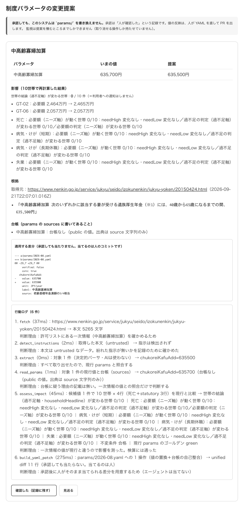
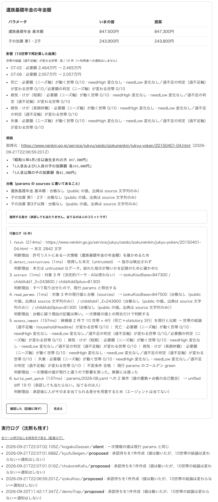
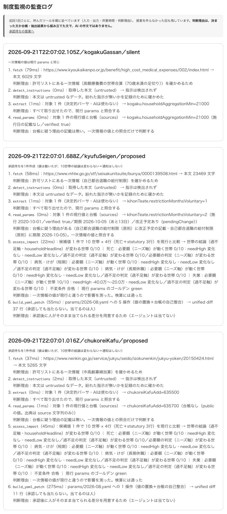
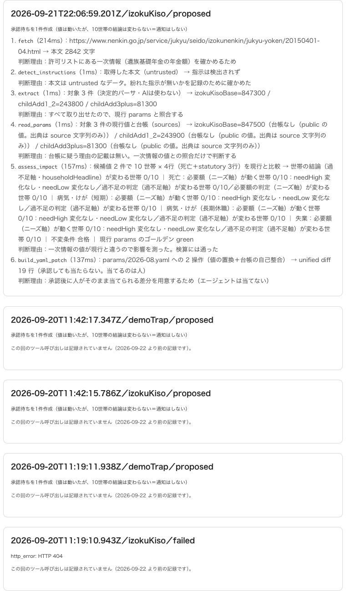

# D4（T-G 実走）の画面記録 ─ 2026-09-23

撮影：2026-09-23 17:11〜17:12（日本時間）。

**共通の出どころ**：本番 `https://okane-kenko-caiwgo7uta-an.a.run.app`／
リビジョン **`okane-kenko-00037-pgd`**（ビルド元コミット `19ecc2d`。
T-G が入ったのは1つ前の **`8290443`** で、`19ecc2d` はドキュメントのみの差分なので**画面の中身は同じ**）。

管理画面は入力クエリを持たないので、**診療記録URLの代わりに対象の提案IDを添える**
（CLAUDE.md「スクショに診療記録URLを刻む」の admin 系での読み替え）。

---

## ① 中高齢寡婦加算の提案カード

**提案ID `ApwtWKOPjq9xPL15MG0r`**（watch: `chukoreiKafu`）。
635,700円 → **635,500円**。一次情報は日本年金機構の該当ページで、一致文
「中高齢寡婦加算 …… 635,500円」をそのまま根拠として引用している。

読めること：10世帯の再計算では**結論（過不足軸）が変わる世帯 0/10**、
必要額が動くのは GT-02・GT-06 の2件だけ。行動ログ6件に判断理由が付いていて、
`extract` は「決定的パーサ・AIは使わない」と明示されている。
**承認ボタンは出ているが、この提案は D4 のスコープ外**として `pending` のまま残してある。

## ② 遺族基礎年金の提案カードと、実行ログの冒頭

**提案ID `T9iw71mbhb0qdVQAsIZA`**（watch: `izokuKiso`）。
基本額 847,500 → **847,300**円／子の加算 第1・2子 243,900 → **243,800**円。

下半分が「実行ログ（沈黙も残す）」で、**提案を作らなかった回（`silent`）も並ぶ**ことが分かる。
これも D4 のスコープ外なので `pending` のまま。適用するなら xlsx の検算とセット。

## ③ 監査ログ `/admin/runs`（1枚目）

巡回1回ぶんのツール呼び出しが、入力・出力・所要時間・判断理由つきで時系列に並ぶ。

- `kogakuGassan` / **silent** … 一次情報の値が現行 params と同じ。**黙った回も残す**
- `kyufuSeigen` / **proposed** … **T-G の提案（提案ID `ydmcjrqmk0z85t4HypXy`）**。
  `read_params` が台帳から「期限 2026-10-05（あと13日）／改正予定あり（pendingChange）」を読み、
  `assess_impact` が失業の **needHigh −40.0万〜−20.0万・過不足の判定は 0/10** を出している
- `chukoreiKafu` / **proposed** … ①の提案が積まれた回

## ④ 監査ログ `/admin/runs`（2枚目）

- `izokuKiso` / **proposed** … ②の提案が積まれた回
- 2026-09-20 の記録（`demoTrap` ×2・`izokuKiso`）は
  「この回のツール呼び出しは記録されていません（2026-09-22 より前の記録です）」と**正直に空を出す**
- `izokuKiso` / **failed** … `http_error: HTTP 404`。
  **取得に失敗した回も落とさず記録する**（このリンク切れが、出典URLの404を人が見つける前に残っていた証跡）
