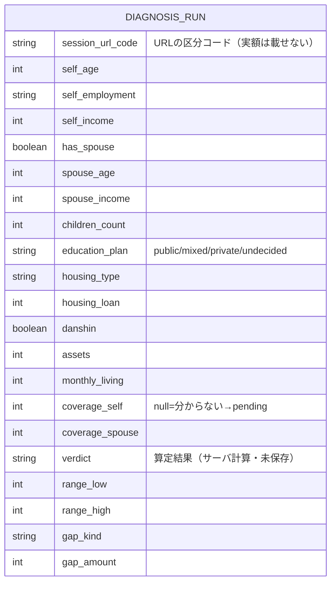
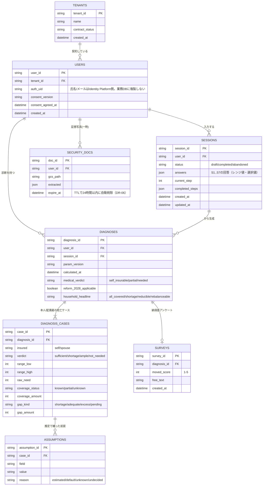

# データモデル図（RDB / ER）

> このプロダクトの永続化設計の**正本は `機能仕様書_MVP.md` §6（Firestore＋BigQuery）**。
> この図は、それを **RDB（リレーショナル）として正規化して表した ER 図**です（共有・レビュー用）。
> 実装は Firestore（NoSQL）想定なので、実際は下記テーブルが**階層コレクション/ドキュメント**になります。
> GitHub 上では Mermaid が図として描画されます。

---

## 現在（Phase A・DBなし）

**いまは DB を永続化していません。** 入力状態は URL（区分コードのみ）に載り、算定はサーバのステートレス計算で、結果は保存していません（T-02 で「DBは使わない」と決定）。
下図は「もし現在の入出力を1テーブルに落とすなら」という**論理エンティティ**です（実際は未永続）。

- **PK/FK なし**＝関係を持たない単一の入出力。永続化しないので個人データは残らない（芯：AIに副作用を持たせない・データを溜めない）。

---

## 将来（Phase B・永続化：§6 を RDB 正規化）

法人契約・マイページ・運営レビュー・分析が入る段階。§6.1 の Firestore ドキュメントを**関係で正規化**すると次の形。

### 分析層（BigQuery・擬名化・非正規化）※ 上のRDBとは別レイヤー
JOIN 前提の正規化ではなく、分析用に**擬名化＋レンジ値のみ**で持つ（DR-05）。
- `fct_step_events`（完走率・設問別離脱）／`fct_diagnoses`（judgment・レンジ）／`fct_surveys`（H2）／`dim_params`（版と結果の紐づけ）
- 制約：氏名・メール・生年月日（年のみ可）・**実額は入れない**。`pseudo_user_id = hash(user_id)`。

---

## 補足
- 実装は Firestore（NoSQL）想定。この RDB 図は**関係の見通し**を共有するためのもので、実装時にコレクション設計へ写す。
- `AI` 出力・ガードレール結果（§6.1 の `ai:` ブロック）は、`DIAGNOSES` に JSON カラムとして持つか `DIAGNOSIS_AI` 子テーブルに分けてよい（T-07/T-08 実装時に確定）。
- 詳細フィールドの正本は `機能仕様書_MVP.md §6`。ここと食い違ったら §6 を正とする。
